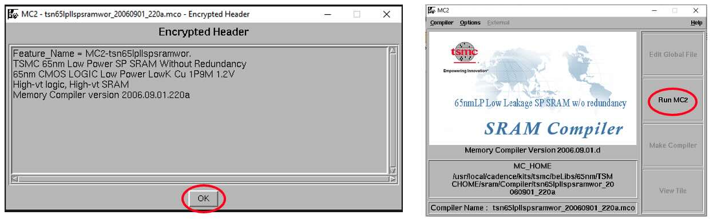
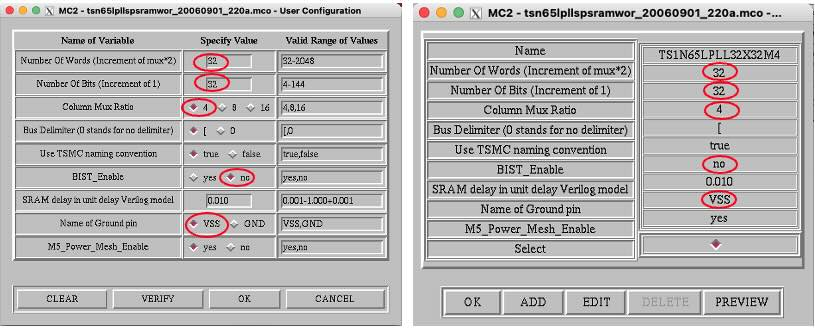
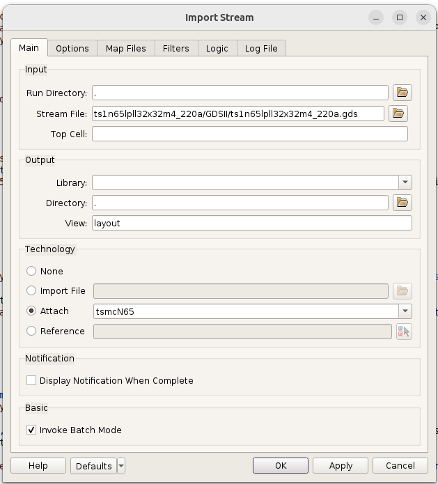
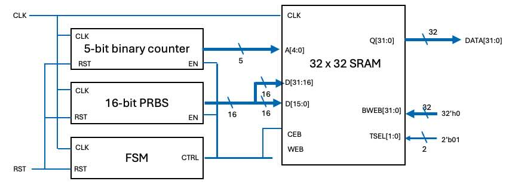
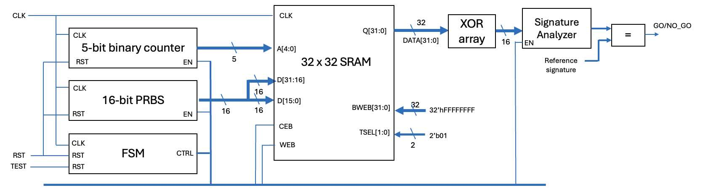
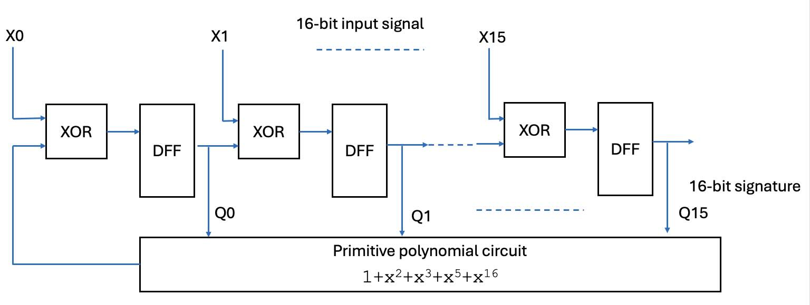

##### Imperial College London, Department of Electrical & Electronic Engineering


#### ELEC70142 Digital VLSI Design

### Lab 3 - Memory and Standard Cells together

##### *Peter Cheung, v3.0 - 22 October 2026*

---
### Objectives
---
By the end of this laboratory session, you should be able to do the following.
* Use TSMC's memory compiler tool to generate efficient memory.
* Build a reference library so that Fusion Compiler can use that memory as a hard macro.
* Integrate a block of logic implemented using standard cells with generated memory.
* Verify that the entire system works properly using simulation.
* Develop a built-in self-test circuit to detect possible error in the circuit.  
* Inject errors into the circuit to check that the automatic fault detection circuit works.

---
### Task 1 - Generate 32 x 32 SRAM
---

This task is about using TSMC's 65nm memory compiler tool to generate a SRAM block. The compiler is TSMC's own program, called **MC2**. It is delivered inside the PDK rather than by Synopsys or Cadence, so it is the same tool whichever vendor's flow you go on to use. You can find the documentation for it at:

```bash
echo $SYN_MEMCOMP_DOCS
ls $SYN_MEMCOMP_DOCS/tsn65lpllspsramwor_20060901_220a
```

**_Step 1: Launch the memory compiler_**

* Create a new directory for this lab, say `Lab_3`, and change to that directory.
* Load the tools and the PDK, exactly as in Labs 1 and 2:

```bash
synopsys tsmc65LP
cd Lab_3
```

* Launch TSMC's **Memory Compiler** with:

```bash
memcomp spsram
```

>The argument **_spsram_** generates a single port RAM with a write port with its own write address and data input, and one read port with its own read address and data out.
>The argument **_dpsram_** generates a dual port RAM with a single write port (own address and data), and two separate read ports.


* Click **_OK_** and **_Run MC2_** in the pop-up windows.

<p align="center">  </p><BR>

**_Step 2: Specify configuration for the memory_**

1. In the dialogue box select "netlist" and click "Enter User Defined Configuration variable".
2. A form will popup with default memory parameters. Click **_Edit_**.
3. Change the variables to the following:
   * Number of Words = 32
   * Number of Bits = 32
   * Column Mux Ratio = 4
   * Name of Ground pin = VSS
   * BIST_Enable = no
   * Check that the memory parameters you selected match that in the diagram below.

<p align="center">  </p><BR>

4. Set the operating point by clicking **_Other Options_** at the top to reveal the operating point selections. Click **_Next_**, and select **_tt1p2v25c_** to set the operating point to 1.2V and 25 degrees C.
5. Click **_OK_** then **_PREVIEW_**. You will see a bounding box showing the size of the memory produced by the memory compiler. Record the dimensions in your logbook.
6. In the Configuration window, click **_AutoName Memory_** button.
7. Select the **_Models_** option at the top and click **_Select ALL_** to generate the full set of models.
8. Finally, click **_Run_** to run the compiler. Then click **_Quit_** to exit the Memory Compiler programme.

Examine the directory for this lab and the files the memory compiler generated.

> In particular, examine the Verilog netlist for the memory block in `VERILOG/`. Record in your logbook the names of the input and output ports and their purposes.

**_Step 3: Build the reference library_**

Genus and Innovus read a memory's Liberty and LEF files directly. Fusion Compiler does not: it reads **NDM**, the same format as the standard cell library you checked in Lab 1. So before you can synthesise with the memory, it has to be built into one:

```bash
make sram
```

>That runs two scripts. `scripts/sram_lib.tcl` compiles the Liberty to a Synopsys database with Library Compiler, and `scripts/sram_ndm.tcl` builds the NDM from that and the LEF with Library Manager. They are separate because the two tools are separate executables.

The library lands in `NDM/` beside the memory's other views. Check it:

```bash
fc_shell
```
```tcl
open_lib ts1n65lpll32x32m4_220a/NDM/ts1n65lpll32x32m4_220a.ndm
get_attribute [get_lib_cells */TS1N65LPLL32X32M4] width
get_attribute [get_lib_cells */TS1N65LPLL32X32M4] height
```


**_Step 4 - Examine the layout of the memory block_**

>The following procedure imports the GDSII layout into the Custom Compiler layout editor. With it you can examine the layout the memory compiler produced.

* Launch Custom Compiler:

```bash
custom &
```
* Create a new library attached to tsmcn65, call it mem_lib.
* From the Custom Compiler window, use **_File -> Import -> Stream ..._**. An **_Import Stream_** dialogue box will open.

<p align="center">  </p><BR>

* Fill in the **_Main_** tab and leave every other tab at its defaults:

| Section | Field | Value |
|---|---|---|
| Input | **_Run Directory_** | `.` |
| Input | **_Stream File_** | the `.gds` in your memory's `GDSII` folder |
| Input | **_Top Cell_** | `TS1N65LPLL32X32M4` |
| Output | **_Library_** | `mem_lib` |
| Output | **_Directory_** | `.` |
| Output | **_View_** | `layout` |
| Technology | | **_Attach_**, and pick `tsmcN65` from the dropdown |

* Click **_OK_**. 

* Open **_Tools -> Library Manager_**, select **_mem_lib_**, then the cell with your memory's name, and open its **_layout_** view.
* Press **_f_** to fit the layout in the window, then **_SHIFT-f_** to expand the hierarchy and show the mask layers inside each cell.
* Hide the `VIA1`, `VIA2` and `VIA3` layers to reveal the circuit underneath.

---
### Task 2 - Combine memory block with standard cell design
---

The purpose of this task is to synthesise a block of logic with **Fusion Compiler**, then place and route it **together** with the memory block from Task 1.

**_Step 1: Specify logic circuit in SystemVerilog_**

<p align="center">  </p><BR>

The block diagram shows the 32 x 32-bit SRAM created in Task 1 surrounded by three modules:
1. A 5-bit address counter.
2. A 16-bit PRBS generator (from Lab 1). The random output from the PRBS generator is used as data to upper and lower 16-bit words of the memory.
3. A FSM that produces the necessary control signals. The FSM should write 32 words generated by the PRBS to fill the SRAM. It should then read the 32 words stored. Then it should write the next 32 words before reading them out etc..

>Note that CEB (Chip Enable) and WEB (Write Enable) signals are active low (hence the letter 'B').

Design these three modules in SystemVerilog and create a top-level design to combine these four blocks to implement the circuit shown.

Make a directory for them:

```bash
mkdir src
```

The scripts read four files by name, so use these:

| File | Module |
|---|---|
| `src/memtest.sv` | top level |
| `src/counter.sv` | 5-bit address counter |
| `src/control.sv` | FSM |
| `src/PRBS.sv` | 16-bit PRBS generator |

Your testbench goes in the same place, as `src/memtest_tb.sv`.


**_Step 2: Synthesize the design with Fusion Compiler_**

```bash
fc_shell -f scripts/syn_logical.tcl
```

This is Lab 1's synthesis script. Two things in the log are worth reading:


**_Step 3: Generate the physical layout_**

```bash
fc_shell -f scripts/pnr.tcl
```

Everything specific to the macro happens in `scripts/floorplan.tcl`. 

When it finishes, look at it:

```tcl
start_gui
```

>You can also run the whole thing as physical synthesis, as in Lab 1 Task 5, with `fc_shell -f scripts/fusion.tcl`. It uses the same floorplan.

**_Step 4: Examine the layout_**

The flow writes a GDSII stream at `outputs/logical/memtest.gds`. Import it into Custom Compiler and examine it.

**_Step 5: Design a testbench_**

Write a testbench. Put it in `src/memtest_tb.sv`.

Then simulate at all three levels, as in Lab 1 Task 4:

```bash
make sim-rtl
make sim-synth
make sim-layout FLOW=logical
```

---
### Task 3 - Memory Self-test
---

<p align="center">  </p><BR>

The system above is an extension of the circuit in Task 2 with a built-in self-test circuit. Instead of inspect the output from the simulator, this circuit  compresses the SRAM output sequence to produce an expected 16-bit signature. Deviation from the expectation indicates an error in the circuit.

In Lab 1, you designed a serial signature analyzer that compress sequence of '1's and '0's to a 16-bit signature.  This circuit can be modified into a parallel signature analyzer that produces a unique signature for a 32-bit, instead of 1-bit, input using the circuit shown below.

<p align="center">  </p><BR>

This parallel signature analyzer circuit "merges" the 32-bit output values from the SRAM with the LFSR Q outputs, and produces a signature for stored contents in the SRAM.

You will also need to modify the FSM to ensure that a test cycle is performed whenever the test input command goes from low to high, and produces the 32-bit signature. This can then be compared with the expected value and produces a GO/NO_GO output.

> [Here](https://www.partow.net/programming/polynomials/index.html#deg32) is a useful reference on  primitive polynomials for degrees 3 to 32.

Check that your self-test circuit works by connecting one of the data output of the SRAM to ground, thus injecting a stuck-at-0 fault into the circuit.


---
#### Challenge (if you have time)
---

You can synthesis a 32x32 SRAM using registers in standard cell.  Write a 32x32 SRAM block in SystemVerilog and use Fusion Compiler to create the layout.  Compare the size and timing for this synthesized SRAM with the layout generated by TSMC's memory compiler.